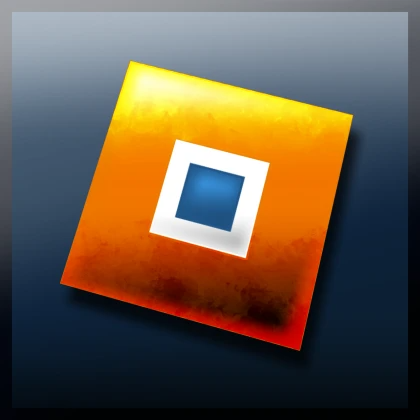

# [OFFICIAL RELEASE] Staticaliza's Blender Animation Tools for Roblox

  

The extension adds three tabs to Blender's 3D View sidebar (press `N` to open it):

- **Roblox Animator** — import, rig, animate, and export Roblox characters.
- **Roblox Animator Utils** — extra animation, posing, camera, and rig tools.
- **Roblox Animator Impact** — create and export anime-style impact frames.

Supports **Blender 4.2 through Blender 5.2**. Select a rig and enter **Pose Mode** to use most animation tools.

## Current Versions

- **Roblox Animator Utils:** 1.7.0
- **Roblox Animator Impact:** 1.0.0
- **Extension Setup:** 1.0.0

## Installation

1. Download `staticaliza_blender_animation_tools.zip` from the [latest GitHub release](https://github.com/Staticaliza/Staticaliza-Blender-Animation-Tools/releases/latest).
2. In Blender, open **Edit > Preferences > Get Extensions**.
3. Choose **Install from Disk** and select the ZIP.
4. Enable **Staticaliza's Blender Animation Tools** and allow online access to install all three tools.

To update all three tools, open **Roblox Animator > Configuration** and click **Install Latest Extensions**.

It is **highly recommended** to install the [Staticaliza's Blender Animation Tools](https://create.roblox.com/store/asset/118148792788940/Staticalizas-Blender-Animation-Tools) and [RBXMonkey](https://create.roblox.com/store/asset/16708835782/) plugins in Roblox Studio.

## Features

- **Animation**: Use Dynamic Parent, Dynamic Unparent, Collision, Gyro, and Ragdoll with Key Start, Key End, and Key Split controls.
- **Rigging and posing**: Work with multiple rigs, use Smart Draggers, and switch transform orientation and Bone/Object pivots.
- **Onion skins and pins**: Preview poses in Single or Multiple mode, and keep reference poses with Onion Pins.
- **Cameras**: Attach cameras to bones and keyframe camera views.
- **Impact frames**: Create anime-style linework with lighting, shapes, effects, and live previews, then export PNG sequences.
- **Import and export**: Import Roblox rigs and move animations and camera data between Blender and Roblox Studio.

## Shortcuts

| Shortcut | Action |
| --- | --- |
| `Tab` | Toggle animation loop in Animate/Animation/Graph workspaces |
| `F` | Toggle Onion Skin using the last selected Single/Multiple mode |
| `Shift + F` | Create or manage Onion Pins |
| `Ctrl + F` | Open Animation Tools |
| `Y` | Switch Global/Local orientation |
| `Shift + Y` | Switch Bone/Object pivot |
| `Ctrl + Y` | Switch Move/Rotate gizmo |

## Credits

- Project and releases authored by **Staticaliza**.
- [Cautioned/Blender-Animations-Plugin](https://github.com/Cautioned/Blender-Animations-Plugin)

## License

This project is licensed under the **GNU General Public License v3.0 or later (GPL-3.0-or-later)**. See [LICENSE](LICENSE) for the full text.
